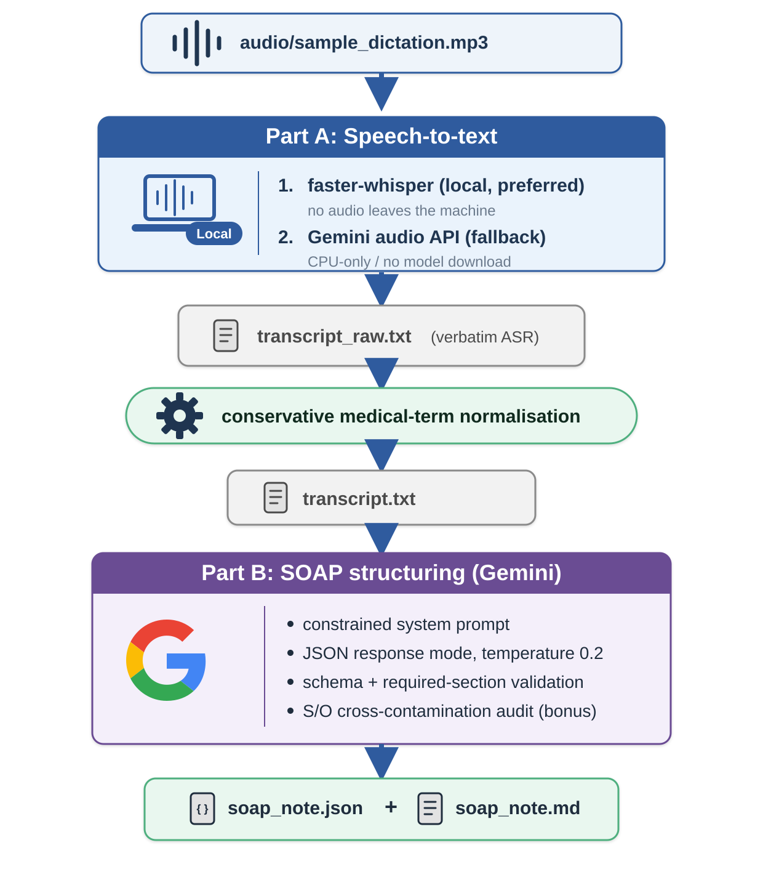

# Medical Transcription → SOAP Note Pipeline

End-to-end pipeline that transcribes a provider's medical dictation and converts the transcript into a structured **SOAP note** (Subjective, Objective, Assessment, Plan).

- **Part A — Speech-to-Text:** `faster-whisper` locally, with a Gemini multimodal fallback.
- **Part B — Text-to-SOAP:** constrained prompt engineering + JSON response mode, followed by a cross-contamination audit.
- **Deliverables:** executed Jupyter notebook, raw/normalised transcripts, SOAP note in JSON and Markdown, tests, and this README.

---

## Results at a glance

| Input / output | File |
|---|---|
| Provider dictation audio (13 min 45 s) | [`audio/sample_dictation.mp3`](audio/sample_dictation.mp3) |
| Verbatim ASR output (before terminology cleanup) | [`output/transcript_raw.txt`](output/transcript_raw.txt) |
| Final transcript used for structuring | [`output/transcript.txt`](output/transcript.txt) |
| Structured SOAP note (JSON) | [`output/soap_note.json`](output/soap_note.json) |
| Rendered SOAP note (Markdown) | [`output/soap_note.md`](output/soap_note.md) |
| Executed walkthrough notebook | [`medical_transcription_soap.ipynb`](medical_transcription_soap.ipynb) |

The encounter is a telehealth visit for several months of right lateral elbow pain, worse with repetitive wrist extension/line work, with point tenderness over the lateral epicondyle and pain on wrist extension/flexion. The note concludes **lateral epicondylitis (tennis elbow)** and documents conservative management.

Example excerpt from [`output/soap_note.md`](output/soap_note.md):

```markdown
## Assessment
- Lateral epicondylitis (also known as tennis elbow), likely predisposed by repetitive strain at work and continuous contraction of the wrist extensor muscle group.

## Plan
- Imaging: Not deemed necessary as there was no trauma and no concern for fractures.
- Activity modifications: Avoid overly repetitive activities at work, especially those using extensor forearm muscles.
- Support: Use a compression sleeve.
- Medications: Continue taking Tylenol or NSAIDs (ibuprofen) for pain.
- Physical therapy: Recommended to increase mobility and strength in the arm.
- Modalities: Apply ice for pain and swelling.
- Prognosis: Should resolve in a couple of months with physical therapy, compression, and splints, lasting at most six months to two years.
```

---

## Architecture

<p align="center">
  
</p>

---

## Tool selection and trade-offs

| Layer | Choice | Why |
|---|---|---|
| ASR (preferred) | **faster-whisper** (`small` by default) | Runs fully offline for PHI/HIPAA-sensitive audio. CTranslate2 INT8 inference is substantially faster and lighter than the original `openai-whisper` implementation while using the same Whisper weights. `small` is a practical CPU compromise for medical vocabulary. |
| ASR (fallback) | **Gemini `gemini-3.5-flash-lite`** | No GPU or model download required, handles 13+ minutes of audio natively, and produced the included transcript on a CPU-only machine. |
| Structuring | **Gemini `gemini-3.5-flash-lite`** | Strong biomedical entity recognition, native `application/json` response mode, and low-temperature sampling for stable section assignment. |
| Validation | Custom heuristics | Cheap, explainable, and catches the classic S/O placement error without another model call. |

**Why not a local model for Part B?** A local Llama/Mistral via Ollama/vLLM is the natural next step for full privacy (see [Scaling](#scaling-notes)); the `SOAPNoteGenerator` interface makes that swap straightforward.

### Reproducibility note

`faster-whisper` was not installed on the machine used to prepare this repository, so the included transcript was produced by the **Gemini fallback**. The code still prefers local Whisper whenever it is available. To reproduce the included transcript without another ASR call, the notebook can run with `USE_SAVED_TRANSCRIPT=1` (see [Usage](#usage)).

Cloud ASR is non-deterministic: repeated runs can differ by a word or two. The included transcript is complete and preserves the clinical terminology; the normalisation layer fixes the remaining high-confidence errors.

---

## Repository structure

```text
medical-transcription-soap/
├── audio/
│   └── sample_dictation.mp3        # Sample dictation (13:45)
├── docs/
│   └── architecture.svg            # Pipeline diagram
├── output/
│   ├── transcript_raw.txt          # Verbatim ASR output (audit trail)
│   ├── transcript.txt              # Normalised transcript used for SOAP
│   ├── soap_note.json              # Structured S/O/A/P JSON
│   └── soap_note.md                # Rendered clinical note
├── tests/
│   ├── test_soap_generator.py      # Parsing, schema, S/O validation
│   └── test_medical_lexicon.py     # Terminology normalisation
├── config.py                       # Env-overridable paths and settings
├── transcriber.py                  # faster-whisper + Gemini backends, retries
├── medical_lexicon.py              # Conservative post-ASR corrections
├── soap_generator.py               # Prompt, JSON parsing, S/O audit
├── pipeline.py                     # CLI end-to-end runner
├── medical_transcription_soap.ipynb # Executed walkthrough
├── requirements.txt
├── requirements-dev.txt
├── .env.example
├── LICENSE
└── README.md
```

---

## Quick start

### Prerequisites

- Python **3.10+** (tested with 3.13.7 on Windows).
- A **Gemini API key** — required for SOAP generation and for the cloud ASR fallback.
- Optional: `ffmpeg`/`ffprobe` (not required by the pipeline; only the notebook's duration display uses `ffprobe` if present).

### 1. Clone

```bash
git clone <repository-url>
cd medical-transcription-soap
```

### 2. Create a virtual environment and install

**Windows PowerShell**

```powershell
python -m venv .venv
.\.venv\Scripts\Activate.ps1
pip install -r requirements.txt
```

**Linux / macOS**

```bash
python3 -m venv .venv
source .venv/bin/activate
pip install -r requirements.txt
```

> `faster-whisper` is included in `requirements.txt`. It downloads the selected model on first use. If installation is a problem on your platform, skip it and the pipeline will automatically use Gemini.

### 3. Set the API key

**Windows PowerShell**

```powershell
$env:GEMINI_API_KEY="your-api-key-here"
```

**Windows Command Prompt**

```bat
set GEMINI_API_KEY=your-api-key-here
```

**Linux / macOS**

```bash
export GEMINI_API_KEY="your-api-key-here"
```

You can copy [`.env.example`](.env.example) for reference. The code reads the key from the process environment; it does not commit or log it.

### 4. Run the end-to-end pipeline

```bash
python pipeline.py
```

This reads `audio/sample_dictation.mp3` and writes all four files into `output/`.

Useful variants:

```bash
# Force the local, privacy-preserving backend (requires faster-whisper)
python pipeline.py --backend local --whisper-model small

# Force cloud ASR (reproduces the included transcript setup)
python pipeline.py --backend gemini

# Keep a run separate from the included outputs
python pipeline.py --output-dir runs/experiment-1

# Disable the terminology cleanup (keep pure ASR output)
python pipeline.py --no-normalize
```

Positional audio path:

```bash
python pipeline.py path/to/another_dictation.mp3
```

### 5. Open the notebook

```bash
jupyter notebook medical_transcription_soap.ipynb
```

The notebook is already executed. To re-run it:

```bash
jupyter nbconvert --to notebook --execute --inplace medical_transcription_soap.ipynb
```

A fresh run transcribes the audio again (non-deterministic cloud output). To reuse the included raw transcript and only redo normalisation + SOAP:

```powershell
# PowerShell
$env:USE_SAVED_TRANSCRIPT="1"
jupyter nbconvert --to notebook --execute --inplace medical_transcription_soap.ipynb
```

```bash
# Linux / macOS
USE_SAVED_TRANSCRIPT=1 jupyter nbconvert --to notebook --execute --inplace medical_transcription_soap.ipynb
```

### 6. Run the tests

```bash
pip install -r requirements-dev.txt
pytest -q
```

The tests cover JSON extraction (including fenced/noisy responses), required-section validation, Markdown rendering, the S/O cross-contamination rules, and terminology normalisation. They make **no API calls**.

---

## Configuration

All settings are environment-overridable in [`config.py`](config.py).

| Variable | Default | Purpose |
|---|---|---|
| `GEMINI_API_KEY` | — | Required for SOAP + cloud ASR |
| `GEMINI_MODEL` | `gemini-3.5-flash-lite` | Structuring model |
| `GEMINI_TRANSCRIPTION_MODEL` | same as above | Cloud ASR model |
| `GEMINI_TEMPERATURE` | `0.2` | Structuring randomness |
| `WHISPER_MODEL_SIZE` | `small` | `tiny`/`base`/`small`/`medium`/`large-v3` |
| `WHISPER_DEVICE` | `auto` | `cpu`, `cuda`, or auto-detect |
| `WHISPER_BEAM_SIZE` | `5` | Decoding accuracy/speed trade-off |
| `SOAP_OUTPUT_DIR` | `output` | Output folder override |
| `API_MAX_RETRIES` | `3` | Retry count for cloud calls |

---

## Prompt engineering

The system prompt in [`soap_generator.py`](soap_generator.py) is the main accuracy control. It explicitly:

1. **Constrains the source of truth.** The transcript is the only permitted source; the model must not invent vitals, labs, imaging, medications, dosages, or follow-up intervals. Missing sections are marked `"Not documented in the provided dictation."`
2. **Separates S from O by author.** Subjective is patient-reported; Objective is clinician-observed/measured/tested. Guided self-palpation in a telehealth visit is documented as an examination finding.
3. **Preserves clinical detail.** Laterality, numbers, units, time frames, pertinent negatives, and medical terminology are retained.
4. **Defines the output contract.** Exactly four JSON string keys, newline-separated `- ` bullets, no commentary outside the JSON.
5. **Uses deterministic-ish sampling.** `temperature=0.2` plus JSON response mode reduces formatting drift.

The response is parsed defensively (direct JSON → fenced JSON → first balanced object) and rejected if any of the four sections is missing.

### Bonus: cross-contamination check

`SOAPNoteGenerator._validate_soap()` audits both directions:

- Objective-style phrases (`on exam`, `palpation`, `tenderness`, `vital signs`, `x-ray`, `imaging shows`, …) inside **Subjective**.
- Subjective-style phrases (`patient reports`, `states that`, `denies`, `rates pain`, …) inside **Objective**.

It emits warnings for human review rather than blocking the note, because a phrase such as "full range of motion" can legitimately be patient-reported. The note produces **zero warnings**.

### Medical terminology normalisation

ASR models occasionally mis-hear uncommon clinical words. [`medical_lexicon.py`](medical_lexicon.py) applies a deliberately narrow, auditable correction list (`supernate → supinate`, `adducing → adducting`, `scolidal → skeletal`, `throbby → throbbing`, and a phrase-level `shortness of breath or reason → … or wheezing`). It never removes disfluencies or paraphrases. The unmodified ASR output is always kept as `transcript_raw.txt`; every substitution is logged by the pipeline.

---

## Output reference

`output/soap_note.json`:

```json
{
  "subjective": "- Chief complaint: ...\n- Onset: ...",
  "objective": "- Inspection: ...\n- Palpation: ...",
  "assessment": "- Lateral epicondylitis (tennis elbow).",
  "plan": "- Imaging: ...\n- Physical therapy: ..."
}
```

`output/soap_note.md` renders the same content as a readable clinical note with headings.

`output/transcript_raw.txt` is the verbatim ASR text (including disfluencies). `output/transcript.txt` is the same content after the conservative terminology pass and is the input to Part B.

---

## Limitations

- **Cloud dependency for SOAP.** Part B requires a Gemini key in this build. A local model adapter is the obvious production swap.
- **No speaker diarization.** The transcript does not label provider vs patient; the prompt infers roles from clinical context. Multi-party encounters would benefit from `pyannote.audio`.
- **Non-deterministic ASR.** Cloud transcription can vary slightly between runs; the included raw transcript is preserved and the notebook can reuse it.
- **Heuristic safety check.** The S/O audit is lexical, not semantic. It is a review aid, not a compliance guarantee.
- **Synthetic/sample data.** The audio is a sample encounter; no real PHI is included. The repo still follows privacy-first defaults (local ASR preferred, key never logged).

---

## Scaling notes

1. **Full local/air-gapped mode.** Run `faster-whisper large-v3` on an on-prem GPU node and serve a local instruction-tuned model (Llama 3 / Mistral) via vLLM or Ollama behind the existing generator interface. No PHI leaves the network.
2. **Asynchronous processing.** Put upload → ASR → structuring on a queue (Celery/RabbitMQ/Redis) so 10–30 minute dictations do not block HTTP requests. Store job state and retries.
3. **EHR integration.** Map the JSON to HL7 FHIR `DocumentReference`/`Composition`; keep an audit record of raw ASR, prompt version, model version, and clinician edits.
4. **Diarization and role attribution.** Add `pyannote.audio`; feed speaker roles into the prompt for multi-party visits.
5. **Quality monitoring.** Track WER on a de-identified gold set, review all cross-contamination warnings, and sample clinician edits to detect prompt drift.
6. **PHI handling.** Encrypt audio at rest/in transit, use short-lived signed URLs, redact logs, and apply retention/deletion policies. The Gemini Files API upload is deleted in a `finally` block by `GeminiTranscriber`.

---

## License

MIT — see [`LICENSE`](LICENSE).
